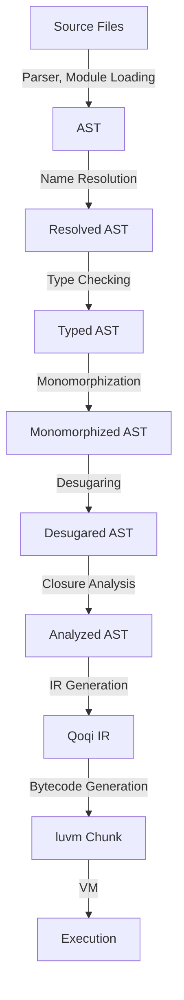

# Qoqi Compilation Pipeline

This document describes how Qoqi source code becomes luvm bytecode: the
stages, the packages that implement them, what each one consumes and produces,
and the rules that hold across stages. Each stage has its own document with
the details; this one is the map.

## Overview

Compilation is a linear pipeline. Each stage either transforms the program or
computes information about it for the stages that follow.



The whole pipeline is driven by one function, `compiler.Compile`, which is what
`qoqi run`, `qoqi check`, `qoqi dump` and `qoqi serve` call.

## Package Structure

| Package | Stage | Input | Output | Details |
|---------|-------|-------|--------|---------|
| `internal/token` | — | — | Token and position types | |
| `internal/ast` | — | — | AST node types | |
| `internal/errors` | — | — | `Diagnostic`, `Handler` | [diagnosis.md](diagnosis.md) |
| `internal/parser` | 1. Parsing | source text of one file | `*ast.Program` | [parsing.md](parsing.md) |
| `internal/stdlib` | — | — | The standard library's source, compiled into the binary | [../stdlib.md](../../reference/language/stdlib.md#how-it-is-built) |
| `internal/modules` | 1. Module loading | entry file, file reader | one `*ast.Program` for all files | [module_loading.md](module-loading.md) |
| `internal/resolve` | 2. Name resolution | AST | `*resolve.Table` | [name_resolution.md](name-resolution.md) |
| `internal/types` | 3. Type checking | AST, table | `*types.Info` | |
| `internal/monomorph` | 4. Monomorphization | AST, types | AST with concrete instances | [monomorphization.md](monomorphization.md) |
| `internal/desugar` | 5. Desugaring | AST, types | simplified AST | [desugaring.md](desugaring.md) |
| `internal/analysis` | 6. Closure analysis | AST, table | `*analysis.CaptureInfo` | [../closure-spec.md](../closures.md) |
| `internal/ir` | — | — | IR data structures and builder | |
| `internal/irgen` | 7. IR generation | AST, captures | `*ir.Program` | [ir_generation.md](ir-generation.md) |
| `internal/codegen` | 8. Bytecode generation | IR | `*vm.Chunk` | [bytecode_generation.md](bytecode-generation.md) |
| `internal/compiler` | Driver | source text | `*compiler.Result` | this document |
| `internal/vm` | Execution | chunk | result value | [../luvm.md](../vm.md) |

---

## The Driver (`internal/compiler`)

```go
errs := errors.NewHandler()
result := compiler.Compile(src, "main.qi", errs)   // or compiler.CompileFile(path, errs)

if errs.HasErrors() {
    for _, d := range errs.Diagnostics {
        fmt.Fprintln(os.Stderr, d.String())
    }
    return
}
value, err := vm.NewVM().Exec(result.Chunk)
```

`Result` exposes what each stage produced, which is what the tooling and the
tests inspect:

| Field | Content | Nil when |
|-------|---------|----------|
| `AST` | The program as parsed | never |
| `Lowered` | The program after monomorphization and desugaring | an earlier stage failed |
| `IR` | The intermediate representation | an earlier stage failed |
| `Chunk` | Executable bytecode | **any** stage reported an error |

### Rule 1: stop at the first failing stage

After every stage the driver checks `errs.HasErrors()` and returns if it is
set. A later stage therefore never sees a program that an earlier one
rejected. This has two consequences worth knowing:

* A stage can assume its input is valid for everything the earlier stages
  check. IR generation, for instance, does not re-check that names exist.
* One run reports the errors of **one** stage. A file with a syntax error and
  a type error shows the syntax error first; the type error appears once the
  syntax is fixed. Within a stage, as many errors as possible are reported.

A `Chunk` is only returned when the handler holds no error at all, so a caller
cannot accidentally run a program that failed to compile.

### Rule 2: recompute names and types after the AST changes

Name resolution and type checking attach their results to AST **nodes**
(`map[*ast.Ident]*Symbol`, `map[ast.Expr]Type`). Monomorphization and
desugaring build new nodes: cloned generic functions, rewritten loops,
temporaries. Those nodes are missing from the tables computed earlier.

Instead of having every transformation patch the tables, the driver runs the
resolver and the checker again on the transformed program (`reanalyze`), after
monomorphization and after desugaring. The fresh tables are what desugaring,
closure analysis and IR generation use.

Diagnostics from these extra runs are **discarded**. The source program already
passed both checks, so anything reported now would describe compiler-generated
code and be meaningless to the user. This is safe because IR generation
verifies the one property it depends on: every name it reads is a local, a
captured variable or a known function, otherwise it reports `E5002`.

### Rule 3: reject what cannot be compiled, early and by name

Some constructs parse but have no implementation further down. `checkSupported`
(in `unsupported.go`) runs right after parsing and reports them as `E7001`
with a suggestion, rather than letting them fail later with an error about
internals the user never wrote:

| Construct | Message |
|-----------|---------|
| `extern fn` the runtime has no function for | the runtime has no function '...' (`E7002`, from `checkExterns`) |
| match patterns other than literals, types, enum variants and `default` | this kind of match pattern is not supported yet |

When one of these gets implemented, remove its entry here.

---

## Pipeline Steps

### 1. Parsing (`internal/parser`)

**Goal**: Turn source text into an AST, reporting syntax errors with precise
locations and recovering to report several per file.

*   **Input**: source text, file name
*   **Output**: `*ast.Program`
*   **Notes**: Assignment has no AST node of its own; `x = 1` is a
    `BinaryExpr` with operator `"="`. See [parsing.md](parsing.md).

### 2. Name Resolution (`internal/resolve`)

**Goal**: Link every identifier usage to its declaration. Ensure no undefined variables or shadowing conflicts (unless allowed).

*   **Input**: `*ast.Program`
*   **Output**: `*resolve.Table` (Mapping of `ast.Node` to `Scope/Symbol`).
*   **Key Responsibilities**:
    *   Build symbol tables for each scope (global, function, block, lambda).
    *   Seed the global scope with the builtin functions.
    *   Detect "undefined variable" and "redeclaration" errors.
*   **Testing Strategy**:
    *   Unit tests with snippets of code checking if `x` resolves to the correct declaration of `x`.
    *   Negative tests for undefined variables.

### 3. Type Checking (`internal/types`)

**Goal**: Verify that operations are performed on compatible types and assign types to every expression.

*   **Input**: `*ast.Program`, `*resolve.Table`
*   **Output**: `*types.Info` (Mapping of `ast.Expr` to `types.Type`).
*   **Key Responsibilities**:
    *   Type inference for variables.
    *   Check function call arguments against signatures, including variadic ones.
    *   Check binary/unary operator compatibility and assignments.
    *   Type member access (struct fields), indexing and lambdas.
    *   Type method calls: the method must exist on the receiver's struct or
        trait, arguments are checked against its signature, and `Self` is the
        receiver's type.
    *   Validate trait implementations, and that a struct passed where a trait
        is expected implements it.
    *   Treat `T?` as `T | null` and refuse to use it unless a `??` fallback or
        a test against `null` rules null out (flow typing, in `flow.go`).
    *   Check casts, reject assignments to constants, and require a return on
        every path of a function that returns a value.
    *   Substitute explicit type arguments into generic signatures, and infer
        them when they are left out, from the arguments and then from the
        type expected of the result. Inferred arguments are written into the
        AST, so monomorphization sees an explicit call.
    *   Narrow variables and fields by null tests and type tests. For fields
        this relies on knowing which functions may assign a field, computed
        over the call graph before bodies are checked (`findFieldWriters`).
    *   Record, for the back end, what each cast and type test must verify
        and the signature of every function (`types.Info`).
*   **`Any` and `unknown` are different things.** `Any` is a type the
    programmer writes: everything fits into it, nothing comes out of it. When
    the checker cannot type an expression because it already reported an error
    there, it uses the internal type `unknown`, which is compatible with
    everything so that one mistake produces one diagnostic. `unknown` never
    appears in a program that compiles, except as the element type of an empty
    array literal on its way to a typed place.
*   **Its types drive code generation.** IR generation asks for the type of a
    method call's receiver to decide between a direct call and a runtime
    lookup, so the type information computed after desugaring has to be
    complete; see [ir_generation.md](ir-generation.md#structs-and-methods).
*   **Testing Strategy**:
    *   Test cases for type mismatches (e.g., `1 + "string"`).
    *   Test cases for valid complex type interactions.

### 4. Generics Resolution / Monomorphization (`internal/monomorph`)

**Goal**: Instantiate generic functions and structs for concrete types used in the program.

*   **Input**: `*ast.Program`, `*types.Info`
*   **Output**: `*ast.Program` (Modified AST with concrete instances).
*   **Key Responsibilities**:
    *   Identify all calls to generic functions.
    *   Generate concrete versions of functions/structs for each unique type argument set.
    *   Replace generic calls with calls to the concrete versions.
    *   *Note*: This step might expand the AST significantly.
*   **Testing Strategy**:
    *   Verify that a generic function called with `Int` and `Float` generates two distinct functions.

### 5. AST Desugaring (`internal/desugar`)

**Goal**: Simplify the AST by transforming complex constructs into simpler ones.

*   **Input**: `*ast.Program` (Monomorphized)
*   **Output**: `*ast.Program` (Simplified).
*   **Key Responsibilities**:
    *   Convert `for` loops into `while` loops.
    *   Convert `match` statements into `if-else` chains.
    *   Lower type patterns to type tests.
    *   Short-circuit operators are *not* rewritten; see [desugaring.md](desugaring.md#4-short-circuit-operators---).
*   **Testing Strategy**:
    *   Input AST with a `for` loop -> Output AST with equivalent `while` loop structure.

### 6. Closure Analysis (`internal/analysis`)

**Goal**: Identify variables captured by closures.

*   **Input**: `*ast.Program`, `*resolve.Table`
*   **Output**: `*analysis.CaptureInfo` (Map of functions to captured variables).
*   **Key Responsibilities**:
    *   Detect free variables in function literals: parameters, `let` variables,
        loop variables and `self` of an enclosing function.
    *   Propagate captures through intermediate functions. If the innermost of
        three nested lambdas uses a variable of the outermost, the middle one
        must capture it too, even though it never mentions it; it is marked
        `FromUpvalue` there.
*   **Testing Strategy**:
    *   Test that a variable used inside a returned lambda is marked as captured.

### 7. IR Generation (`internal/irgen`)

**Goal**: Translate the fully analyzed and simplified AST into Linear IR (Intermediate Representation).

*   **Input**: `*ast.Program`, `*analysis.CaptureInfo`
*   **Output**: `*ir.Program`.
*   **Key Responsibilities**:
    *   Generate `ir.Function` for each function, method and lambda.
    *   Generate `ir.BasicBlock`s for control flow.
    *   Translate expressions into register-based instructions.
    *   Lower short-circuit operators, assignments, struct literals, method
        calls, variadic calls and closures.
*   **Details**: [ir_generation.md](ir-generation.md)

### 8. Bytecode Generation (`internal/codegen`)

**Goal**: Turn the IR into a chunk the VM can execute.

*   **Input**: `*ir.Program`, names of the host functions
*   **Output**: `*vm.Chunk`
*   **Key Responsibilities**:
    *   Assign physical registers, reusing them for short-lived values.
    *   Build the constant pool, string pool and function table.
    *   Lay out basic blocks and resolve jumps.
    *   Attach source positions to instructions, for runtime errors and for the console to show where an instance is.
    *   Enforce the limits of the bytecode format.
*   **Details**: [bytecode_generation.md](bytecode-generation.md)

---

## Error Handling Strategy

All stages report through one `errors.Handler` from `internal/errors`, passed
in by the caller. No stage prints, panics or returns its own error type for a
problem in the user's program.

*   **Accumulation**: A stage keeps going after an error to report as many
    problems as it can; the driver stops between stages (Rule 1).
*   **Rich Reporting**: Diagnostics carry an error code, the source line and
    the span to underline, and a suggestion where one is useful.
*   **Codes**: Each stage owns a range. The full list is in
    [diagnosis.md](diagnosis.md).

| Range | Stage |
|-------|-------|
| `E0xxx` | Parsing |
| `E1xxx` | Name resolution |
| `E2xxx` | Type checking |
| `E3xxx` | Monomorphization |
| `E4xxx` | Desugaring, closure analysis |
| `E5xxx` | IR generation |
| `E6xxx` | Bytecode generation |
| `E7xxx` | Compiler driver |

Runtime errors are a separate channel: `VM.Exec` returns a Go `error` whose
text includes the source location recorded by bytecode generation.

## Inspecting the Pipeline

```bash
qoqi dump --ir program.qi           # IR after stage 7
qoqi dump program.qi                # bytecode listing after stage 8
```

From Go, `compiler.Result.AST`, `.Lowered` and `.IR` give the same views;
`result.Lowered.String()` prints the desugared program as source-like text,
which is the quickest way to see what a loop or a match was turned into.

## Adding a Language Feature

A typical feature touches the stages in order. Using the existing ones as a
template:

1.  **Parser**: produce the AST for the new syntax (add the node to
    `internal/ast` if needed). Test: `internal/parser/parser_test.go`.
2.  **Resolver / checker**: visit the new node so names inside it are resolved
    and typed. An unvisited expression silently gets no type.
3.  **Desugar** *or* **irgen**: either rewrite the construct into existing ones
    (preferred when possible, nothing below needs to change) or lower it to IR.
4.  **Codegen / VM**: only if it needs a new IR operation or instruction.
5.  **Tests**: one feature test in `internal/compiler/compiler_test.go` that
    runs a program using it, and an entry in `docs/language-spec.md`.
6.  If it was listed in `checkSupported`, remove it there.
